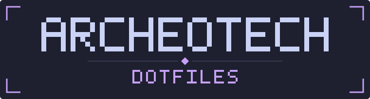
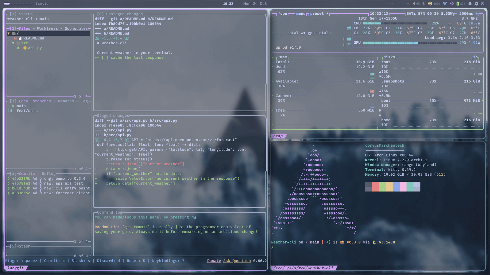

<div align="center">



My Arch Linux + MangoWC setup, running the [Archeotech shell](https://github.com/Nicolas-Rigaudy/archeotech-shell).

[](https://archlinux.org)
[](https://github.com/DreamMaoMao/mangowc)
[](https://www.gnu.org/software/stow/)



</div>

> [!NOTE]
> These are personal configs for one machine: an Intel laptop at 1920x1200 that docks at two desks, AZERTY built in, QWERTY at work.
> Monitor names, paths and binds reflect that. The shell itself lives in [archeotech-shell](https://github.com/Nicolas-Rigaudy/archeotech-shell).

## What's inside

| | Software |
|---|---|
| Compositor | [MangoWC](https://github.com/DreamMaoMao/mangowc) (scrolling layouts), Hyprland as a fallback at the login screen |
| Shell | [archeotech-shell](https://github.com/Nicolas-Rigaudy/archeotech-shell) on Quickshell; waybar, swaync and wlogout under Hyprland |
| Terminal | kitty, fish, starship, atuin, navi |
| Terminal apps | yazi, lazygit, btop, bat, cava, zathura |
| Desktop | rofi, swaylock, swayidle, GTK 3/4, xdg-desktop-portal |
| System | SDDM, snapper + snap-pac + grub-btrfs, logid, systemd units |
| Theme | Catppuccin Macchiato by default; the shell's theme switch rewrites kitty, rofi, fish, starship, GTK and the MangoWC borders |

A few things that make it mine:

- **Docking.** A hotplug watcher applies the right monitor layout per desk, portrait screen included.
- **Project jump.** `Super + Ctrl + P` lists every git repo and opens VS Code and a terminal in the one you pick.
- **Two keyboards.** `Alt + Shift` switches AZERTY and QWERTY, and the binds stay on the same physical keys.
- **Gaming mode.** `Super + Ctrl + G` turns blur, shadows and animations off, and back on.
- **Snapshots.** Every pacman transaction takes a btrfs snapshot, bootable from GRUB.

## Installation

> [!WARNING]
> Read the configs before you run this. `install.sh` backs up existing `~/.config` entries, but it replaces them.

On an Arch install with `paru`:

```sh
git clone https://github.com/Nicolas-Rigaudy/archeotech-dotfiles.git ~/Projects/archeotech-dotfiles
cd ~/Projects/archeotech-dotfiles
./scripts/install.sh --dry-run --profile full   # preview
./scripts/install.sh --profile full             # packages, then configs
```

`--profile minimal` installs only the required packages. Then install the shell with
[its own installer](https://github.com/Nicolas-Rigaudy/archeotech-shell#installation).
Starting from a blank disk? [`docs/INSTALLATION.md`](docs/INSTALLATION.md) covers the full Arch install
with btrfs subvolumes, snapshots and both compositors.

GNU Stow links `config/.config/*` into `~/.config`, so the live config is the repo file:

- Add an app: create `config/.config/<app>/`, add it to `CONFIGS` in `scripts/install.sh`, run `stow -R config`.
- Remove the links: `./scripts/uninstall.sh`. The repo stays intact.

<details>
<summary><b>Layout</b></summary>

```
config/.config/   the Stow package: every app config
scripts/          install, monitor hotplug, project jump, gaming mode, snapper setup
system/etc/       SDDM, snapper, logid and systemd files for /etc
packages/         PKGBUILD for a scenefx patch that smooths blurred panel edges
ci/               container checks for the compositor configs
wallpapers/       wallpapers and their credits
docs/             installation, keybinds, packages, tools
```

</details>

## Keybinds

The main ones. Full lists: [MangoWC](docs/KEYBINDS-MANGO.md), [Hyprland](docs/KEYBINDS.md).
In the session, `Super + K` shows them all in the shell's keybinds panel.

| Keybind | Action |
|---|---|
| `Super + Q` | Terminal (kitty) |
| `Super + R` | Launcher |
| `Super + Ctrl + P` | Project jump |
| `Super + K` | Keybinds panel |
| `Super + ,` | Settings |
| `Super + W` | Wallpaper picker |
| `Super + Space` | Scroller layout |
| `Super + Shift + T` | Layout picker |
| `Super + Ctrl + G` | Gaming mode |
| `Super + Shift + R` | Reload MangoWC and the shell |

## Docs

- [Installation](docs/INSTALLATION.md): from a blank disk to a running desktop
- [Packages](docs/PACKAGES.md): what is installed and why
- [Tools](docs/TOOLS.md): configuration and usage of each tool
- [US International layout](docs/KEYBOARD-US-INTL.md)

## Credits

- [MangoWC](https://github.com/DreamMaoMao/mangowc) and [Quickshell](https://quickshell.org).
- [end-4](https://github.com/end-4/dots-hyprland), [HyDE](https://github.com/HyDE-Project/HyDE), [JaKooLit](https://github.com/JaKooLit/Hyprland-Dots) and [ML4W](https://github.com/mylinuxforwork/dotfiles) for ideas on structure and install flow.
- [Catppuccin](https://github.com/catppuccin) for the palettes. Wallpapers belong to their authors, see [`wallpapers/CREDITS.md`](wallpapers/CREDITS.md).

Personal configs, shared as they are. Take anything useful.
