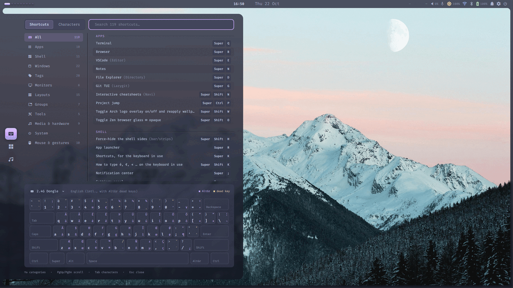
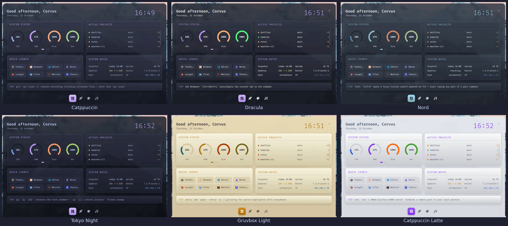

<div align="center">


### An Arch Linux desktop on MangoWC, in one repo. Clone it, run one script, get the same machine back.


<sub>MangoWC scrolling layout with kitty, yazi and fastfetch, under the Archeotech shell. Isolated render.</sub>

</div>

---

These are the configs of a work laptop that docks at two desks. MangoWC tiles the windows,
the [Archeotech shell](https://github.com/Nicolas-Rigaudy/archeotech-shell) draws the bar and panels,
and kitty, fish, starship, rofi, GTK and the terminal tools share one Catppuccin theme.
Every file lives in this repo. GNU Stow links it into `~/.config`. An edit is a git change.
Hyprland stays configured as a fallback, selectable at the login screen.

## A day on this desktop

- **Login.** SDDM offers MangoWC or Hyprland. MangoWC starts the shell, the wallpaper, clipboard history and the idle lock.
- **Docking.** Plug in two monitors. A hotplug watcher applies the right layout, portrait screen included.
- **Coding.** `Super+Ctrl+P` lists every git repo and opens VS Code and a terminal in the one you pick.
- **Typing.** The laptop is AZERTY, the desk keyboard is QWERTY. `Alt+Shift` switches and the binds still work.
- **Gaming.** One toggle turns blur, shadows and animations off for a full-screen game, and back on after.
- **Updating.** Every pacman transaction takes a btrfs snapshot. A bad update rolls back from the boot menu.

## Why it is built this way

| Usual dotfiles pain | Here |
|---|---|
| Copying files back and forth | **Stow symlinks**: the live config is the repo file |
| A fresh install that takes a day | **`install.sh --profile full`**: packages, backup, deploy, checks |
| A config change that breaks the session | **Isolated CI**: compositor configs are verified in a container |
| Monitors in the wrong place after docking | **Hotplug layouts** per desk, with a wildcard for unknown screens |
| An update that breaks boot | **Snapper + snap-pac + grub-btrfs** snapshots |
| A theme that differs per app | **One theme switch** from the shell for kitty, rofi, fish, starship, GTK and MangoWC |

## See it

### Every bind, for the keyboard in use
The shell's keyboard panel reads the MangoWC binds from this repo and labels them for the active layout.



### One theme across the desktop
The theme picked in the shell rewrites kitty, rofi, fish, starship, GTK, hyprlock and the MangoWC borders in this repo.



## What is configured

| Area | Tools |
|---|---|
| Compositor | MangoWC (primary, scrolling layouts), Hyprland (fallback) |
| Shell | [archeotech-shell](https://github.com/Nicolas-Rigaudy/archeotech-shell) on Quickshell; waybar, swaync and wlogout for Hyprland |
| Terminal | kitty, fish, starship, atuin, navi |
| Terminal apps | yazi, lazygit, btop, bat, cava, zathura |
| Desktop | rofi, swaylock, swayidle, GTK 3/4, xdg-desktop-portal |
| System | SDDM, snapper, logid, systemd units (in `system/`) |

## Get started

On an Arch install with `paru`:

```sh
git clone https://github.com/Nicolas-Rigaudy/archeotech-dotfiles.git ~/Projects/archeotech-dotfiles
cd ~/Projects/archeotech-dotfiles
./scripts/install.sh --dry-run --profile full   # preview
./scripts/install.sh --profile full             # packages, then configs
```

`install.sh` backs up any existing `~/.config` entry before it links the repo in.
`--profile minimal` installs only the required packages. Then install the shell from
[archeotech-shell](https://github.com/Nicolas-Rigaudy/archeotech-shell) with its own installer.

Starting from a blank disk? [`docs/INSTALLATION.md`](docs/INSTALLATION.md) covers the full Arch install
with btrfs subvolumes, snapshots and both compositors.

These are personal configs for one machine (an Intel laptop, 1920x1200, AZERTY). Monitor names, paths and binds
reflect that setup. Read before you run.

<details>
<summary><b>What is in the box</b></summary>

| Path | What |
|---|---|
| `config/.config/` | the Stow package: every app config |
| `scripts/install.sh`, `install-packages.sh` | deploy with Stow, install packages by profile |
| `scripts/monitor-hotplug.sh`, `monitor-apply.sh` | layout per set of connected monitors |
| `scripts/project-jump.sh` | rofi picker for git repos |
| `scripts/gaming-mode.sh` | turn compositor effects off and on |
| `scripts/setup-snapper.sh`, `update-system-configs.sh` | snapshots, and deploy of `system/` files |
| `scripts/archeotech-live.sh` | pin the running shell to a commit while the dev checkout moves |
| `system/etc/` | SDDM, snapper, logid and systemd files for `/etc` |
| `packages/scenefx-coverage/` | PKGBUILD for a scenefx patch that smooths blurred panel edges |
| `ci/` | container checks for the compositor configs |
| `wallpapers/` | wallpapers with their [credits](wallpapers/CREDITS.md) |
| `logics/` | planning for this repo and the shell |

</details>

<details>
<summary><b>Day-to-day use</b></summary>

- Edit `~/.config/<app>/...` as usual. It is the repo file.
- Add an app: create `config/.config/<app>/`, add it to `CONFIGS` in `scripts/install.sh`, run `stow -R config`.
- Remove the links: `./scripts/uninstall.sh`. The repo stays intact.
- Reload MangoWC and the shell: `Super+Shift+R`.

</details>

## Documentation

- [Installation](docs/INSTALLATION.md): from a blank disk to a running desktop
- [MangoWC keybinds](docs/KEYBINDS-MANGO.md) and [Hyprland keybinds](docs/KEYBINDS.md)
- [US International layout](docs/KEYBOARD-US-INTL.md)
- [Packages](docs/PACKAGES.md): what is installed and why
- [Tools](docs/TOOLS.md): configuration and usage of each tool

## License

Personal configs, shared as they are. Take anything useful.
Wallpapers belong to their authors, see [`wallpapers/CREDITS.md`](wallpapers/CREDITS.md).
