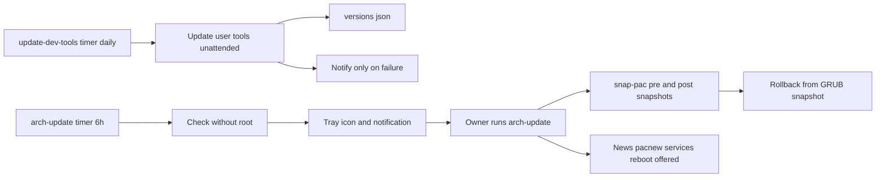

## adr_036_two_tier_machine_updates_unattended_user_tools_owner_run_arch_update - Two-tier machine updates: unattended user tools, owner-run arch-update for the system
> Date: 2026-11-17
> Status: Accepted
> Related request: `req_013_automatic_updates_system_packages_aur_npm_globals_and_user_tools`
> Related backlog: `item_175_update_policy_adr_rollback_runbook_and_docs`
> Related task: `task_082_orchestrate_automatic_updates`
> Drivers: the owner updated the laptop by hand and too often; an unattended pacman -Syu is unsafe on Arch (news-flagged manual steps, pacnew merges, kernel swap without reboot)
> Reminder: Update status, linked refs, decision rationale, consequences, and follow-up work when you edit this doc.

# Overview
- Updates are split in two tiers. User tools in `~/.local` update unattended once a day. System packages (pacman + AUR) are checked unattended but only applied when the owner runs arch-update. Nothing reboots the machine on its own.

# Context
- User tools (Claude Code, logics-manager and Codex via npm -g, cdx, pipx venvs, uv tools, rtk, codebase-memory-mcp) live in `~/.local`, need no root, and a bad version only breaks that one tool. Each keeps a rollback path (`rtk.prev`, versioned cbm dirs, pinned npm/pipx/uv reinstalls; `docs/UPDATES.md`).
- System packages need root, and an unattended `pacman -Syu` fails in the ways the Arch wiki System maintenance page warns about: news items that require a manual step before the upgrade, `.pacnew` files left unmerged, partial upgrades, and a kernel swap that removes the running kernel's modules until the next boot.
- Safety already on the machine: snap-pac takes a pre/post snapper snapshot around every pacman transaction, grub-btrfs lists those snapshots in the GRUB menu, `/var/cache` is its own subvolume so the package cache survives a root rollback.
- The first plan was a custom `sysup` script (item_174). On 2026-11-09 the owner chose arch-update (AUR, github.com/Antiz96/arch-update) instead: it already does the wiki steps in order (news since the last run, upgrade with paru, then orphans, package cache, pacnew/pacsave, services to restart, pending kernel reboot), runs its check without root on a temporary sync db, and has a tray icon and notifications. item_174 was retired Obsolete.

# Decision
- **Tier 1, user tools: unattended.** `update-dev-tools.timer` (daily, `Persistent=true`, up to 30 min random delay) runs `scripts/update-dev-tools.sh`: one updater per install method, each tool in its own process under a 10 min timeout with 3 attempts, so one failure never blocks the rest. Results go to `~/.local/state/archeotech-updates/versions.json`. One critical `tool-failed` notice per day lists the tools that failed; a clean run is silent.
- **Tier 2, system: checked unattended, applied by the owner.** `arch-update.timer` (from the package, enabled by `install.sh`) runs `arch-update --check` at login and every 6 h: no root, no write to `/var/lib/pacman/sync`. A pending update changes the tray icon in the bar and sends one notification with a run action. The owner starts the upgrade (tray click, notification, or `arch-update` in a terminal); every post-upgrade step is offered, never forced.
- **Why arch-update over a custom script:** it is maintained against the wiki procedure, already handles the news gate, pacnew, services and kernel reboot, and comes with the tray and notifier. A custom script would duplicate it and need its own tests. Config lives in `config/.config/arch-update/arch-update.conf` (paru, keep 2 cached versions, no flatpak).
- **No unattended `-Syu`, ever.** No pacman hook, timer or script applies system packages without the owner at the keyboard.
- **No unattended reboot.** A kernel upgrade waits for the owner's yes in arch-update, or the next normal reboot.
- **Cadence:** systemd user timers only (no login hook, no cron). `Persistent=true` catches up a missed daily run at the next login or resume; the script waits up to 30 min for DNS because a resume catch-up starts before Wi-Fi is back.
- **Rollback** for the system tier is a snap-pac snapshot booted from the GRUB snapshot menu, then a manual subvolume swap (this layout mounts `subvol=@` by path, so `snapper rollback` alone does not take effect). Steps in `docs/UPDATES.md` (Rollback runbook).
- **Fallback kernel:** none installed today (`linux` only). Adding `linux-lts` is an owner decision: it would give a second GRUB entry when a new kernel does not boot, at the cost of a second kernel to upgrade and about 45 MB on `/boot` (628 MB free on 2026-11-17).

# Consequences
- The owner acts only on a notification: system updates available (arch-update), a tool update failed (user-tool job). None when nothing is due.
- System upgrades happen when the owner chooses, so a pending update can sit for days. The tray icon keeps it visible.
- `/boot` is a separate ext4 partition, not snapshotted. Booting a snapshot after a kernel upgrade loads the new kernel against the snapshot's old modules, and rolling root back leaves `/boot` on the new kernel. The runbook reinstalls the matching `linux` package from the cache (kept by `KeepOldPackages=2`) after a rollback.
- Without `linux-lts`, a kernel that fails to boot is fixed from a live USB (`arch-chroot`, `pacman -U` the previous `linux` from `/var/cache/pacman/pkg`).
- grub-btrfs snapshot entries boot read-only (no overlayfs hook; the initramfs is systemd-based). That is enough to log in on a TTY and do the rollback.
- crow (cr-0w req_045) reads `versions.json` and never runs an updater.

# References
- `docs/UPDATES.md` (scripts, state files, daily flow, rollback runbook)
- `scripts/update-dev-tools.sh`, `scripts/update-notify.sh`, `scripts/update-state.sh`, `config/.config/systemd/user/update-dev-tools.service`, `config/.config/systemd/user/update-dev-tools.timer`
- `config/.config/arch-update/arch-update.conf`, `config/.config/xdg-terminals.list`, mango `exec_once` tray line, `scripts/install.sh` (`enable_user_services`)
- `scripts/setup-snapper.sh`, `system/etc/snapper/configs/root`
- https://wiki.archlinux.org/title/System_maintenance
- https://wiki.archlinux.org/title/Snapper (restoring / to a previous snapshot)
- https://github.com/Antiz96/arch-update
