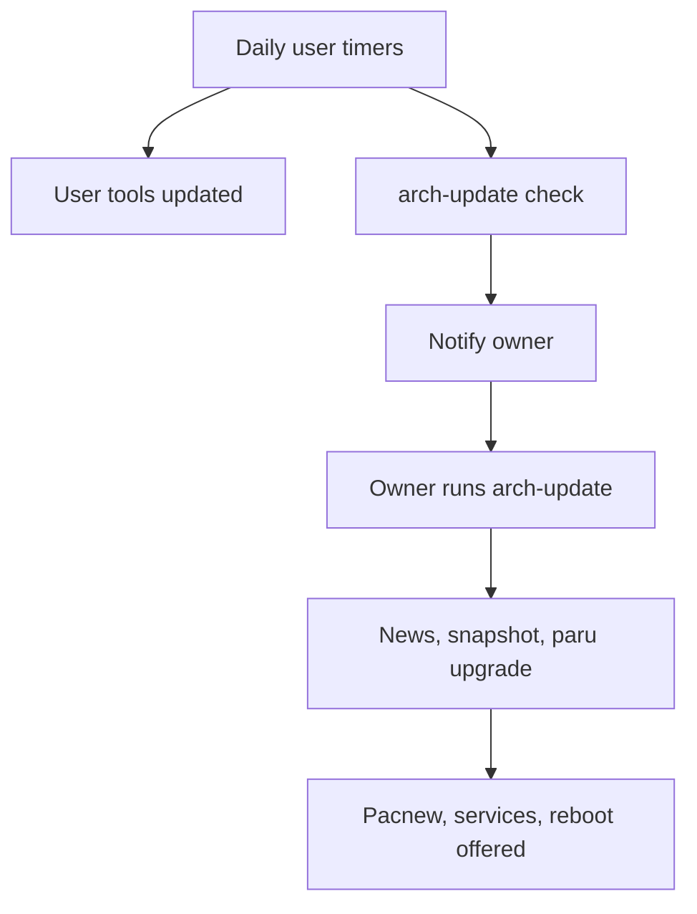

## prod_006_automatic_machine_updates - Automatic machine updates
> Date: 2026-11-09
> Status: Proposed
> Related request: `req_013_automatic_updates_system_packages_aur_npm_globals_and_user_tools`
> Related backlog: `item_171_update_notifier_and_state_file_shared_by_all_update_jobs`, `item_172_tracked_user_tool_updater_npm_globals_claude_code_codex_cdx_rtk_uv_pipx`, `item_173_daily_system_update_check_with_arch_news_gate`, `item_174_sysup_guarded_system_upgrade_command`, `item_175_update_policy_adr_rollback_runbook_and_docs`
> Related task: `task_082_orchestrate_automatic_updates`
> Related architecture: (none yet)
> Reminder: Update status, linked refs, scope, decisions, success signals, and open questions when you edit this doc.
> Indicators reviewed: 2026-11-09 17:44:32

# Overview
Scheduled, safe updates for the owner's Arch laptop: user tools update unattended, system packages are checked daily and applied with one guarded command, and the owner is notified only when something needs them.

# Goals
- The owner stops checking for updates by hand.
- No system upgrade runs without a news check and a snapshot to roll back to.
- A kernel update never reboots the machine without the owner.

# Non-goals
- Unattended pacman -Syu.
- Changelog reading and impact proposals (crow req_045).
- A pending-updates bar widget in archeotech-shell (later shell item).
- Firmware updates (fwupd) and Flatpak.

# Scope and guardrails
- In: user tools in ~/.local, npm globals, pacman and AUR via paru, Arch news, snapper/snap-pac, desktop notifications.
- Out: unattended system upgrades, automatic reboots, automatic pacnew merges.

# Key product decisions
- Two tiers: user tools update unattended; pacman and AUR are checked by arch-update and applied only when the owner runs it (owner choice 2026-11-09, replaces the custom `sysup` idea).
- systemd user timers with Persistent=true; no login hook.
- Notifications only when the owner has something to do: arch-update for system updates, the user-tool job for failures.
- versions.json is the read surface for crow (cr-0w req_045).

# Success signals
- The owner runs a system upgrade about once a week, prompted by a notice.
- No tool in versions.json is more than a day behind its latest release without a recorded failure.
- No unplanned reboot or broken boot after an upgrade.

# References
- Product back-reference: `req_013_automatic_updates_system_packages_aur_npm_globals_and_user_tools`
- Task back-reference: `task_082_orchestrate_automatic_updates`
