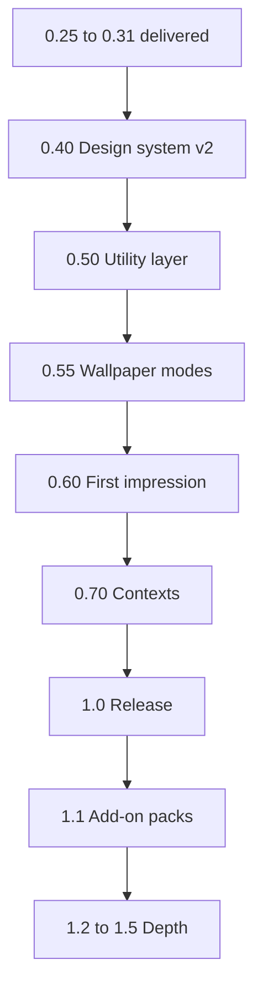

## road_001_archeotech_shell - Archeotech shell
> Date: 2026-11-05
> Status: Proposed
> Related product: `prod_001_archeotech_shell`
> Related request: `req_005_2026_09_28_audit_upgrade_program`
> Reminder: Update status, milestone scope, linked refs, risks, and success signals when you edit this doc.
> Indicators reviewed: 2026-09-29 15:59:05

# AI Context
- Summary: Roadmap for the Archeotech shell, re-sequenced after the 2026-09-28 audit and again on 2026-11-05 (design system v2, utility layer, wallpaper modes, first impression, Contexts, 1.0, add-on packs).
- Keywords: roadmap, milestones, versions, archeotech shell, audit, contexts, add-on packs
- Use when: Planning or sequencing versions for the Archeotech shell.
- Skip when: You need execution details for a single backlog item or task; personal dotfiles work lives on road_002.

# Summary
Plan the path to a public, community-ready 1.0 (v1 bar decided 2026-09-03), re-sequenced after the 2026-09-28 audit (.claude/audits/2026-09-28/). Ordering: safety net, then correctness, then design system, then utility and headline features, then distribution. Owner decisions 2026-09-28: Contexts is the 1.0 headline; Corvus Dataslate is the base identity; identity packs (Grimdark, cyberpunk, gundam) ship as add-ons after 1.0; Angular and HUD were test-only packs; personal items moved to road_002. Scope freeze: new ideas go to 1.1 or later unless they block an exit signal. Re-sequenced 2026-11-05 (owner, from req_008/req_009): Cyberdeck chassis and delegate seams prove pack-out-of-core in 0.40, the rest of Cyberdeck is the 1.1 flagship; wallpaper modes get 0.55; the first impression (motion, README video, Hyprland parity) comes before Contexts, which is time-boxed; Claude Ask, community packs and install by URL move to 1.1; onboarding mode leaves 1.0.

# Milestones
## 0.25 - Stability hardening (delivered)
- `item_005_fix_dock_undock_freeze_wlroots_output_hotplug_on_mangowm_0_16`: Fix dock-undock freeze (wlroots output-hotplug) on mangowm 0.16
- `item_026_multi_monitor_compositor_utilities`: Multi-monitor & compositor utilities
- `item_011_decide_and_apply_lid_close_while_docked_suspend_behaviour`: Decide and apply lid-close-while-docked suspend behaviour
- `task_015_output_hotplug_auto_detect_tags_follow_monitor_gaming_mode_remaining`: output hotplug auto-detect + tags-follow-monitor + gaming mode (remaining)
- `item_043_fix_dashboard_auto_close_right_after_boot`: Fix dashboard auto-close right after boot
- Goal: Rock-solid dock/undock, resume, hotplug and boot behaviour.
- Scope: Delivered before the 2026-09-28 audit.
- Exit signal: Met: dock/undock/resume/hotplug cycles clean.

## 0.26 - Widgets, coherency and theming engine (delivered)
- `item_035_coherency_audit_slice_2_selector_unification_remaining`: Coherency audit Slice 2 - selector unification (remaining)
- `item_036_coherency_audit_slice_3_flat_mode_sweep`: Coherency audit Slice 3 - flat-mode sweep
- `item_037_coherency_audit_slice_4_dedup_inputs`: Coherency audit Slice 4 - dedup + inputs
- `item_038_coherency_audit_slice_5_one_offs_tokens`: Coherency audit Slice 5 - one-offs + tokens
- `item_044_workspace_indicators_3d_polish`: Workspace indicators 3D polish
- `item_050_gradient_sheen_on_nested_cards_experiment`: Gradient sheen on nested cards experiment
- `item_012_flat_glass_aesthetic_settings_toggle_full_rollout`: Flat <-> glass aesthetic Settings toggle full rollout
- `item_008_eager_warm_the_wallpapers_service_at_shell_startup`: Eager-warm the Wallpapers service at shell startup
- `item_048_dashboard_hero_rotating_quote`: Dashboard hero rotating quote
- `item_016_launcher_keyboard_first_master_search`: Launcher keyboard-first master search
- `item_015_auto_hide_sides_in_fullscreen`: Auto-hide sides in fullscreen
- `item_022_visual_builder_drag_and_drop_spatial_zone_representation`: Visual Builder drag-and-drop + spatial zone representation
- `item_063_configschema_auto_forms_plugin_widget_manager_pane`: configSchema auto-forms + Plugin/Widget Manager pane
- `req_003_swappable_widget_faces_and_skins`: Swappable widget faces and skins
- `item_081_theming_capability_surface_engine_token_tree_component_style_registry_decorator_fx_motion_hooks_pack_scoped_settings`: Theming capability surface (engine): token tree, component style registry, decorator/FX + motion hooks, pack-scoped settings
- `item_066_plugin_manifest_schema_official_verified_minshellversion_deps`: Plugin manifest schema (official/verified/minShellVersion/deps)
- `item_067_headless_render_harness_shot_sh_qs_ipc_state_driving`: Headless render harness (shot.sh + qs-ipc state-driving)
- `item_070_compositorservice_facade_mango_hyprland_service_extraction`: CompositorService facade + Mango/Hyprland service extraction
- `item_071_hyprland_config_port_dual_sddm_session_reload_parity`: Hyprland config port + dual SDDM session + reload parity
- `item_073_hardcoded_path_audit_zero_home_corvus`: Hardcoded-path audit (zero /home/corvus)
- `item_074_install_sh_rewrite_install_packages_sh_required_vs_optional`: install.sh rewrite + install-packages.sh (required vs optional)
- Goal: Per-instance widget config, swappable faces, coherency audit slices, theming engine core, render harness, compositor facade, install rewrite.
- Scope: Everything delivered from the former 0.26/0.265/0.27/0.28/0.29/1.0 milestones up to 2026-09-28; open items from those milestones were re-sequenced below after the audit.
- Exit signal: Met for the delivered scope; the 2026-09-28 audit found correctness bugs under it (see 0.31).

## 0.30 - Safety net (delivered)
- `item_101_isolate_shot_sh_fully_and_render_any_worktree`: Isolate shot.sh fully and render any worktree
- `item_102_claude_code_project_tooling_guard_hooks_qt6_lint_skills_and_reviewer_agents`: Claude Code project tooling: guard hooks, Qt6 lint, skills and reviewer agents
- `item_103_live_bar_on_a_pinned_worktree_with_a_promote_script`: Live bar on a pinned worktree with a promote script
- `item_104_docs_and_repo_hygiene_after_the_audit`: Docs and repo hygiene after the audit
- Goal: AI-assisted development can never touch the owner's live session, and every change can be rendered and verified in isolation.
- Scope: Isolated shot.sh with worktree rendering, guard hooks plus Qt6 lint plus skills and reviewer agents, live bar on a pinned worktree, docs hygiene.
- Exit signal: A worktree edit renders headless with the live bar and real HOME untouched (mtime check), and the guard hook blocks every forbidden live-session command.

## 0.31 - Correctness sweep and golden matrix (delivered)
- `item_068_visual_regression_vs_goldens_qml_logic_tests_arch_container_ci`: Visual-regression vs goldens + QML logic tests + Arch-container CI
- `item_105_service_command_runner_queue_and_startup_gating`: Service command runner queue and startup gating
- `item_106_bar_and_strip_widget_instantiation_fixes`: Bar and strip widget instantiation fixes
- `item_107_no_fake_toggles_sweep_controls_bound_to_real_state`: No-fake-toggles sweep: controls bound to real state
- `item_108_toast_osd_and_network_service_hardening`: Toast, OSD and network service hardening
- `item_109_visual_defects_found_in_the_audit_render_matrix`: Visual defects found in the audit render matrix
- `item_049_dashboard_customizable_system_notes_data_reliability`: Dashboard customizable System Notes + data reliability
- Goal: Fix every bug the audit verified and lock the result in with goldens.
- Scope: Service command queue and startup gating, widget instantiation fixes, no-fake-toggles sweep, toast/OSD/network hardening, visual defects from the render matrix, dashboard data reliability, golden matrix with image diff, contrast checks and Arch-container CI.
- Exit signal: scripts/golden.sh passes across themes x packs x modes x panel states and no verified audit bug remains open.

## 0.40 - Design system v2 (current)
- `item_110_semantic_token_layer_with_contrast_floor_and_spacing_type_scales`: Semantic token layer with contrast floor and spacing/type scales
- `item_111_designed_light_themes_with_their_own_surface_recipe`: Designed light themes with their own surface recipe
- `item_112_surface_recipes_and_pack_chrome_out_of_core_primitives`: Surface recipes and pack chrome out of core primitives
- `item_113_primitive_library_completion_with_focus_and_disabled_states`: Primitive library completion with focus and disabled states
- `item_114_unified_motion_presets_with_reduced_motion_and_animation_scale`: Unified motion presets with reduced motion and animation scale
- `item_115_corvus_dataslate_base_identity`: Corvus Dataslate base identity
- `item_116_glass_material_decision_real_blur_or_satin`: Glass material decision: real blur or satin
- `item_117_retire_angular_and_hud_test_packs_to_test_fixtures`: Retire Angular and HUD test packs to test fixtures
- `item_039_glass_themed_system_tray_context_menu_tooltip`: Glass-themed system-tray context menu + tooltip
- `item_130_edit_mode_design_review_and_audit`: Edit mode design review and audit
- `item_045_edit_mode_stragglers_onto_3d_glass_theme`: Edit mode + stragglers onto 3D/glass theme
- `item_017_panel_keybinds_dismissal_consistency`: Panel keybinds / dismissal consistency
- `item_091_accent_picker_for_all_theme_families_with_gtk_fallback`: Accent picker for all theme families with GTK fallback
- `item_006_live_colour_preview_on_scroll_in_pickers`: Live colour preview on scroll in pickers
- `item_007_async_fade_in_on_wallpaper_thumbnails`: Async fade-in on wallpaper thumbnails
- `item_009_palette_crossfade_on_theme_apply`: Palette crossfade on theme apply
- `item_134_settings_audit_fake_controls_missing_settings`: Settings audit: fake controls, missing settings, per-pane gaps
- `item_138_settings_ux_per_setting_search_and_reset`: Settings UX: per-setting search and reset to default
- `item_156_cyberdeck_ornaments_textures_and_panel_styles`: Cyberdeck ornaments, textures and panel styles (delegate seams only in 0.40)
- `item_154_cyberdeck_pack_chassis_palette_roles_and_three_registers`: Cyberdeck pack chassis: palette, roles and three registers
- Goal: A semantic, mode-aware design system with designed light themes, pack chrome out of core, and the Corvus Dataslate base identity.
- Scope: Semantic tokens with a contrast floor, light surface recipe, surface recipes and style delegates, primitive completion with focus/disabled states, unified motion presets, glass decision, retire test packs, plus tray menu, edit mode, dismissal consistency, accent for all families and picker feel. Cyberdeck is the proving pack (owner, 2026-11-05): item_156's delegate seams and item_154's chassis land here because they test item_112's "no pack branch in core" rule with a pack that is not Grimdark; the rest of the pack is 1.1.
- Left (2026-11-05): autonomous: 112 (about 40 platedChrome branches), 113 (IconButton, ListRow, TextField, ComboBox, Scrollbar, focus ring). Owner: 115 contact-sheet sign-off, 130 edit-mode direction, live checks for 039 (tray right-click), 017 (close keybind, Esc on bar popups).
- Exit signal: No hex literal outside tokens, every golden passes AA in glass/flat/light, no pack-specific branch in core (proved by the Grimdark and Cyberdeck chassis rendering with zero core edits), owner signs off on the base contact sheet.

## 0.50 - Daily utility layer
- `item_118_launcher_command_palette_with_providers`: Launcher command palette with providers
- `item_119_notifications_v2_actions_images_grouping_history`: Notifications v2: actions, images, grouping, history
- `item_120_state_driven_osd_generic_panel_ipc_and_keybind_cheatsheet`: State-driven OSD, generic panel IPC and keybind cheatsheet
- `item_121_native_quickshell_networking_and_bluetooth_services`: Native Quickshell Networking and Bluetooth services
- `item_135_display_settings_real_layout_arrangement_profiles`: Display settings: real layout, arrangement, per-output modes and profiles
- `item_136_input_settings_keyboard_layout_repeat_touchpad`: Input settings pane: keyboard layout, repeat, touchpad
- `item_137_clock_format_bar_widget_options_scan_roots_settings`: Clock format, bar widget options and dashboard scan roots in Settings
- Goal: Parity with DMS/Noctalia/Caelestia on the everyday layer.
- Scope: Launcher command palette with providers, notifications v2, state-driven OSD plus generic panel IPC plus keybind cheatsheet, native Networking and Bluetooth. Order (req_008): 118, 119, 120, then 121 last (riskiest, least visible).
- Exit signal: Four rofi scripts retired; notifications support actions, history and grouping; any panel opens by IPC.

## 0.55 - Wallpaper modes
- `req_006_wallpaper_modes`: Wallpaper modes: rotation, per-monitor, weather and effects
- `item_146_wallpaper_source_contract_one_owner_active_mode_plugin_hook`: Wallpaper source contract: one owner, active mode, plugin hook
- `item_147_wallpaper_rotation_through_a_selection`: Wallpaper rotation through a selection
- `item_148_per_monitor_wallpapers`: Per-monitor wallpapers
- `item_033_per_workspace_wallpapers`: Per-workspace wallpapers
- Goal: One wallpaper owner with switchable modes, so rotation, per-monitor and per-workspace wallpapers do not fight.
- Scope: Source contract first (146), then rotation, per-monitor and per-workspace on it. Weather and effect wallpapers (149, 150) are plugins on the 146 hook and wait for 1.4; pack wallpapers (151) go with the packs in 1.1.
- Exit signal: Each mode switches from Settings and survives dock/undock; a plugin can register a mode through the 146 hook.

## 0.60 - First impression
- `item_125_signature_motion_panels_grow_from_the_bar_interruptible`: Signature motion: panels grow from the bar, interruptible
- `item_077_readme_screenshots_demo_gif_v1_0_0_tag`: README screenshots + demo GIF + v1.0.0 tag (video now; the tag stays in 1.0)
- `item_128_fresh_arch_install_test_and_hyprland_service_parity`: Fresh-Arch install test and Hyprland service parity
- `req_012_screensaver_engine_pluggable_sources_settings_picker_and_idle_hook`: Screensaver engine: pluggable sources, Settings picker and idle hook
- `item_161_screensaver_mockups_picker_preview_and_overlay_card_options`: Screensaver mockups: picker, preview and overlay card options
- `item_162_screensaver_engine_core_ipc_target_fullscreen_host_and_dismissal`: Screensaver engine core: IPC target, fullscreen host and dismissal
- `item_163_screensaver_source_plugins_qml_terminal_and_web_examples`: Screensaver source plugins: QML, terminal and web examples
- `item_164_screensaver_settings_source_picker_shuffle_live_preview_timeout`: Screensaver settings: source picker, shuffle, live preview, timeout
- `item_165_dotfiles_idle_hook_swayidle_starts_the_shell_screensaver_before_the_lock`: Dotfiles idle hook: swayidle starts the shell screensaver before the lock
- Goal: What a stranger sees in the first minute: the README video, a shell that feels fluid, and a shell that runs on Hyprland as well as MangoWC (owner, 2026-11-05, from req_009).
- Scope: 125 remainder (shared morph driver with a burst-capture proof, sliding selection highlight, entrance stagger on launcher and settings, all under the 114 reduce-motion switch); the README marketing video per the 2026-10-23 brief; Hyprland service parity plus the scripted fresh-Arch install. The screensaver engine (req_012, owner 2026-11-05; from crow hub req_015): plugin sources (terminal, QML, web), Power pane picker with preview and shuffle, an IPC target swayidle calls before the lock, and a card layer crow and packs draw on.
- Exit signal: Panel morph reverses mid-flight without a jump; the README video is approved by the owner; swayidle starts the screensaver before the lock and a source plugin drops in without core edits; the fresh-Arch install passes the goldens on MangoWC and Hyprland.

## 0.70 - Contexts (time-boxed)
- `item_122_contexts_one_switch_for_project_cloud_and_workspace_state`: Contexts: one switch for project, cloud and workspace state
- `item_013_layout_loadouts_presets`: Layout loadouts / presets (built as a Contexts facet, not separately)
- `item_123_dev_radar_widgets_aws_sso_pill_and_git_pr_ci_radar`: Dev radar widgets: AWS SSO pill and git/PR/CI radar
- Goal: The 1.0 headline: one switch for project, cloud and workspace state, built for the owner's dev and cloud workflow.
- Scope: Contexts switcher (project, AWS/SSO, kube, git identity, layout loadout, accent, focus mode) first and alone, then the AWS SSO pill and git/PR/CI radar that feed its facets. Time-boxed: if it slips, 1.0 ships with 0.60's first-impression set and Contexts moves to 1.1.
- Exit signal: Switching context applies every facet and a prod context turns the accent to danger.

## 1.0 - Distribution and release
- `item_126_versioned_plugin_api_exposing_shell_services`: Versioned plugin API exposing shell services
- `item_127_portability_hardening_for_strangers_machines`: Portability hardening for strangers' machines
- `item_075_scripted_per_variant_theme_symlinks`: Scripted per-variant theme symlinks
- `item_076_api_install_contributing_docs`: API + INSTALL + CONTRIBUTING docs
- `item_072_docs_compositor_support_md_for_both_compositors`: docs COMPOSITOR_SUPPORT.md for both compositors
- `item_010_move_thumbnail_cache_to_freedesktop_shared_path`: Move thumbnail cache to freedesktop shared path
- `item_003_verify_vscode_colorcustomizations_regen_on_non_catppuccin_themes`: Verify VSCode colorCustomizations regen on non-Catppuccin themes
- Goal: Installable by a stranger on fresh Arch, with a versioned plugin API.
- Scope: Versioned plugin API exposing services, portability hardening, theme symlinks, docs, the v1.0.0 tag (owner action; item_077). Moved out 2026-11-05: community packs and install by URL (021, 065) to 1.1; demo/onboarding mode (040) to 1.5; fresh-Arch install and Hyprland parity (128) to 0.60.
- Exit signal: A stranger's fresh-Arch install runs the shell from INSTALL.md alone, and a plugin built against the versioned API loads without core changes.

## 1.1 - Identity packs and add-ons
- `req_001_theming_capability_surface_flagship_identity_packs`: Theming capability surface & flagship identity packs
- `req_011_cyberdeck_theme_pack_droid_console_identity_for_the_shell_and_terminal`: Cyberdeck theme pack: droid console identity for the shell and terminal
- `item_155_cyberdeck_display_font_and_type_scale`: Cyberdeck display font and type scale
- `item_157_pack_controlled_kitty_ansi_slots_so_crow_deck_matches_the_register`: Pack-controlled kitty ANSI slots so crow deck matches the register
- `item_158_crow_agents_module_and_screensaver_in_the_cyberdeck_pack`: Crow agents module and screensaver in the cyberdeck pack
- `item_159_hud_gauge_face_for_system_stats_cpu_ram_disk_battery`: HUD gauge face for system stats (CPU, RAM, disk, battery)
- `item_160_scanner_launcher_style_kill_mode_overlay_and_layout_profiles`: Scanner launcher style, kill-mode overlay and layout profiles
- `item_082_flagship_theme_pack_1_wh40k_shadow_spears_dataslate`: Flagship theme pack #1: WH40K Shadow Spears dataslate
- `item_083_theming_engine_ornament_asset_overlay_fx_pack_font_hook_flagship_gap`: Theming engine: ornament asset-overlay FX + pack font hook (flagship gap)
- `item_078_hud_framing_kit_angular_corners_corner_brackets_reticle_grids_mono_micro_labels`: HUD framing kit (angular corners, corner brackets, reticle grids, mono micro-labels)
- `item_151_theme_pack_wallpapers_grimdark_hud_angular`: Theme pack wallpapers (grimdark, hud, angular)
- `item_051_named_theme_personalities_as_glass_base_variants`: Named theme personalities as glass-base variants
- `item_129_additional_add_on_identity_packs_cyberpunk_and_gundam`: Additional add-on identity packs: cyberpunk and gundam
- `item_021_theme_packs_official_community`: Theme Packs (official + community)
- `item_065_archeotech_plugin_install_mechanism_plugins_json_index`: archeotech plugin install mechanism + plugins.json index
- `item_124_claude_ask_panel`: Claude Ask panel
- Goal: Cyberdeck is the flagship add-on pack; Grimdark and later packs follow on the same mechanics; packs and plugins install from a URL; Claude Ask ships as an add-on surface.
- Scope: The rest of the Cyberdeck pack (font, kitty ANSI slots, crow agents, gauge face, scanner launcher), Grimdark reworked onto the Dataslate base (its mechanics, not its look; owner 2026-11-05), ornament/font engine hooks, HUD framing kit, pack wallpapers, community pack support and install by URL (needs 126), Claude Ask panel (moved from 0.60, owner 2026-11-05).
- Exit signal: Each pack installs from its own repo URL and switches live with no core changes.

## 1.2 - Motion depth and bar chrome
- `req_002_motion_and_fluidity_system`: Motion and fluidity system
- `item_088_bar_container_style_variants_continuous_pills_framed_floating_per_side`: Bar container style variants continuous pills framed floating per side
- Goal: The rest of the motion system after the 0.60 signature morph, and per-side bar container styles.
- Scope: Motion personalities with live preview, micro-interactions, entrance/ambient motion; continuous/pills/framed/floating bar containers.
- Exit signal: Motion is user-tunable with live preview and each side can switch container style.

## 1.3 - Builder depth
- `item_096_visual_builder_applet_grouping_drop_onto_group_zone_merge_into_combined_pill`: Visual Builder applet grouping (drop-onto-group-zone merge into combined pill)
- `item_098_custom_pill_containers_arbitrary_n_separators_containers_per_side_with_chosen_widgets`: Custom pill containers — arbitrary N separators/containers per side with chosen widgets
- `item_046_dashboard_customizable_grid`: Dashboard customizable grid
- `item_047_dashboard_pinnable_projects`: Dashboard pinnable projects
- `item_062_desktop_widget_layer_sprint_21_chunk_3_deferred`: Desktop widget layer (Sprint 21 Chunk 3, deferred)
- `item_087_settings_deep_dive_search_display_modes_deep_linking`: Settings deep-dive search display-modes deep-linking
- `item_064_holder_aware_panels_responsive_vertical_orientation_widgets`: Holder-aware panels + responsive vertical-orientation widgets
- Goal: Deeper layout and dashboard customisation.
- Scope: Applet grouping, N containers per side, dashboard grid and pinnable projects, desktop widget layer, settings deep-dive, holder-aware vertical widgets.
- Exit signal: Every layout feature is reachable from the builder without editing JSON.

## 1.4 - Applets and ambient
- `req_004_creative_applets_and_canvas_visualizations`: Creative applets and canvas visualizations
- `item_153_creative_applets_and_canvas_visualizations`: Creative applets and canvas visualizations
- `req_010_canvas_panel_design_session`: Canvas panel design session: which panels gain from a canvas approach
- `item_079_cava_audio_visualizer_element_bar_dashboard_lock_spectrum_opt_in`: cava audio-visualizer element (bar/dashboard/lock spectrum, opt-in)
- `item_018_lock_screen_customization_widgets_settings_pane`: Lock screen customization / widgets Settings pane
- `item_030_screenshot_recording_improvements`: Screenshot & recording improvements
- `item_149_weather_wallpapers_plugin`: Weather wallpapers plugin
- `item_150_animated_and_effect_wallpapers_plugin`: Animated and effect wallpapers plugin
- `item_023_dev_workflow_bar_widgets_docker_keyboardlayout_capslock`: Dev-workflow bar widgets (Docker/KeyboardLayout/CapsLock)
- Goal: Creative applets and ambient liveliness.
- Scope: Canvas applets (placement decided in the req_010 session with the owner), cava visualizer, lock-screen customisation, screenshot/recording panel, weather and effect wallpapers as plugins on the 0.55 hook, dev bar widgets as plugins.
- Exit signal: At least two applets ship as opt-in plugins.

## 1.5 - Later (unscheduled)
- `item_040_demo_onboarding_mode`: Demo / onboarding mode (cut from 1.0, owner 2026-11-05)
- `item_019_theme_applier_plugins_refactor`: Theme-applier plugins refactor
- `item_020_core_plugin_optional_extraction`: Core -> plugin / optional extraction
- `item_084_migrate_hyprland_config_to_lua_window_rules_per_app_opacity_floating_pip`: Migrate Hyprland config to Lua (window rules, per-app opacity, floating PiP)
- `item_089_niri_and_sway_compositor_services_post_v1_0`: Niri and Sway compositor services post v1_0
- `item_090_zen_browser_dynamic_chrome_theming_palette_follow_no_restart`: Zen browser dynamic chrome theming palette follow no restart
- `item_143_zen_theming_follows_palette`: Zen browser theming that actually follows the shell palette (overlaps item_090; merge when picked up)
- `item_141_theme_library_research_reference_shells`: Theme library research: how the reference shells source light and dark themes
- `req_007_fastfetch_logo_in_the_theme_accent`: fastfetch logo in the theme accent
- `item_152_fastfetch_logo_in_the_theme_accent`: fastfetch logo in the theme accent
- `item_092_author_overview_mermaid_diagrams_for_remaining_adrs`: Author overview mermaid diagrams for remaining ADRs
- Goal: Refactors, reach and small extras that are not needed for the above.
- Scope: Onboarding mode, theme-applier plugins refactor, core-to-plugin extraction, Hyprland Lua config, Niri/Sway services, Zen chrome theming, theme research, fastfetch accent, remaining ADR diagrams.
- Exit signal: Picked up only when a later milestone depends on it or a user asks.

# Sequencing
- Deliver milestones in ascending version order unless dependencies force a documented exception.
- 0.30 gates everything: no shell code work before isolated rendering and guard hooks exist.
- Within a milestone, run High-priority items first and parallelise independent items in separate worktrees.
- 0.40: finish 112 and 113 before any 0.50 feature, since the palette, notifications and cheatsheet are built on those primitives (req_008).
- Keep each increment independently reviewable, verified with an isolated contact sheet, and linked to concrete workflow docs.

# Risks
- Polish churn: about half of past commits were look-and-feel iteration; design work lands through tokens and goldens, and the Cyberdeck work in 0.40 stays limited to the delegate seams and chassis.
- Scope creep: the scope freeze still applies; new ideas go to 1.1 or later unless they block an exit signal. Re-sequenced 2026-11-05 from the req_008 and req_009 proposals.
- Contexts is time-boxed in 0.70; if 1.0 slips, Contexts moves to 1.1 and 1.0 ships with the 0.60 first-impression set.
- Item_115's typography touches every screen; it does not merge without the owner's contact-sheet sign-off.
- Version labels are planning targets, not release promises.

# References
- Product brief(s): `prod_001_archeotech_shell`, `prod_003_archeotech_1_0_after_the_2026_09_28_audit`
- Request(s): `req_005_2026_09_28_audit_upgrade_program`, `req_000_archeotech_shell_dotfiles`, `req_008_r_d_what_to_prioritise_cut_and_defer_after_0_40_proposals`, `req_009_r_d_first_impression_priorities_and_what_to_cut_or_defer`
- Backlog item(s): see milestones
- Task(s): `task_031_orchestrate_2026_09_28_audit_upgrade_program`, `task_076_orchestrate_the_cyberdeck_theme_pack`
- Evidence: .claude/audits/2026-09-28/
